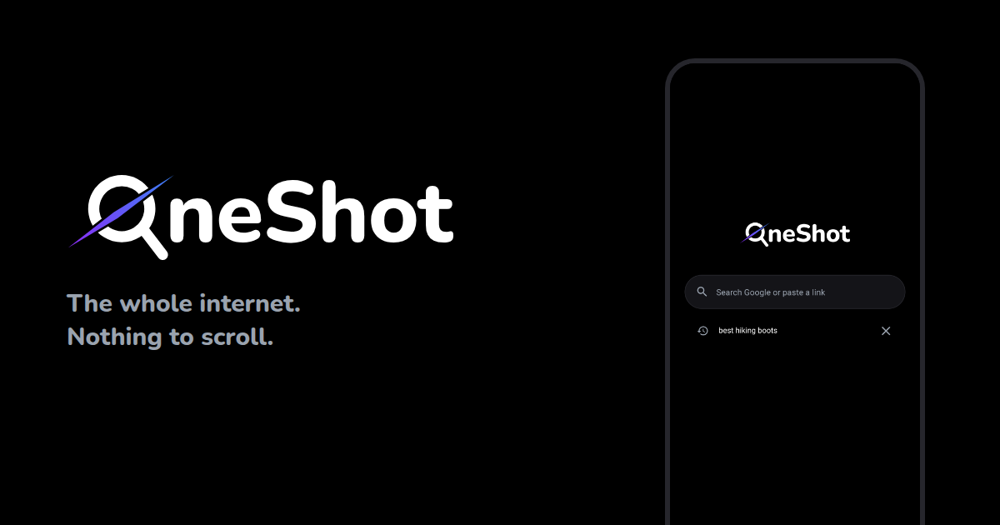

# OneShot

A minimal Android browser for looking things up without getting pulled in. You open it, search or paste a link, get what you came for, and leave: the full utility of the internet with nothing to scroll.

## How it works

- **Home screen:** a search box and your last five searches, each with an X to delete it. Nothing else.
- **One page at a time:** no tabs, no feed, no bookmarks. A search opens Google results; a link opens that page.
- **Back:** from a site, Back returns to the Google results; from the results, it returns to the OneShot home screen. From Google's AI Mode chat, Back returns to the results it was opened from.
- **Top bar:** shows the current search or address, with an X to start a new search. It slides away as you scroll down and back as you scroll up.
- **Default browser:** OneShot can be set as Android's default browser, and also handles shared text and web searches from other apps.

## Google, trimmed to a search tool

- Google's header (logo, menu, Sign in) is hidden on the results page, in AI Mode and in the AI Mode panel; the tabs (All, Images, AI Mode, ...) stay.
- In dark mode, Google's pages are recolored to OneShot's black from the first frame, with no flash of Google's own colors.
- Blue links fade from the logo's purple to its blue.

This is done by a script injected into Google's pages (`GOOGLE_SCRIPT` in `MainActivity.kt`). It matches Google's colors and page structure, so a Google redesign can bring back parts of Google's own look until the script is updated. The page always keeps working.

## What's blocked

**Social sites** are locked to the page you opened:

YouTube, Reddit, Instagram, TikTok, Facebook, X/Twitter, Threads, Pinterest, LinkedIn, Tumblr, 9GAG, Imgur, Quora, Twitch, Bluesky

- Links within the site are blocked; links off it still work.
- Scrolling is capped at three screens.
- Links never escape into the YouTube or Reddit apps.

**Infinite scroll anywhere else:** a page that loads more content twice as you near its bottom counts as a feed, and its scrolling is capped from then on.

**Always allowed:** sign-in, consent and payment pages (Google, Apple, Microsoft, PayPal, Stripe and others), so logins and checkouts don't break.

Every other site works normally, including links to anywhere.

Site lists and limits live in `app/src/main/java/dev/oneshot/app/Policy.kt`.

## What it doesn't stop

OneShot only controls itself. Other browsers and apps on the phone still work, so it helps most when it's the only way online: uninstall or disable other browsers and the social media apps. Sites outside the social list with endless content (news, forums, video sites) are only capped once they're detected as infinite scroll.

## Build

`./gradlew installDebug`
